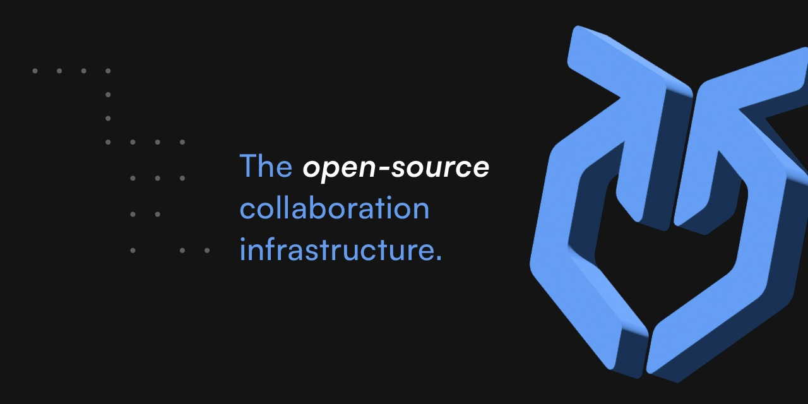

<div align="center">

<p></p>
<a target="_blank" href="https://opensource.org/licenses/Apache-2.0" style="background:none">
    
</a>
<a target="_blank" href="https://github.com/colanode/colanode" style="background:none">
    
</a>
</div>

# Neo Colanode

### Fork de [Colanode](https://github.com/colanode/colanode) : espace de collaboration open-source, local-first et auto-hébergeable

**Neo Colanode** est un fork de [Colanode](https://github.com/colanode/colanode). Il reprend sa base (chat temps réel, pages riches, bases de données, fichiers, synchronisation local-first via CRDT/Yjs) et y ajoute une API publique, un serveur MCP, une organisation des espaces façon Discord, des diagrammes PlantUML et l'export PDF.

> Neo Colanode n'est pas affilié à l'équipe Colanode. Les services hébergés (app.colanode.com, Colanode Cloud EU/US) et l'image Docker `ghcr.io/colanode/server` appartiennent au projet d'origine et **ne contiennent pas** les fonctionnalités de ce fork.

### Fonctionnalités héritées de Colanode

- **Chat temps réel** : messagerie instantanée pour les équipes et les individus.
- **Pages en texte riche** : documents, wikis et notes dans un éditeur proche de Notion.
- **Bases de données personnalisables** : champs, vues (table, kanban, calendrier).
- **Gestion de fichiers** : stockage et partage dans des workspaces sécurisés.
- **Local-first** : tout est écrit dans une base SQLite locale puis synchronisé en arrière-plan ; l'application fonctionne hors ligne.

### Ce qu'ajoute Neo Colanode

- **Rail d'espaces façon Discord** : chaque espace est une icône permanente dans la barre latérale, réordonnable par glisser-déposer ; l'espace actif est mémorisé.
- **Catégories** : nouveau type de nœud `category` pour regrouper pages, canaux, bases et dossiers à l'intérieur d'un espace, avec glisser-déposer entre catégories.
- **Diagrammes PlantUML** : commande `/plantuml` dans l'éditeur et outil PlantUML dédié (menu *Outils*). Le rendu est fait **100 % en local** (`@plantuml/core` + Graphviz WASM), sans appel réseau.
- **Export PDF / impression** : export d'une page en PDF (A4) sur desktop, impression via une iframe isolée sur le web ; les diagrammes PlantUML sont inclus.
- **API publique REST** (`/api`) : workspaces, espaces, nœuds et documents, avec pagination et versioning, authentifiée par **clé API** (`Authorization: Bearer …`).
- **Clés API** : création, liste et révocation au niveau du compte ou du workspace, depuis l'interface.
- **Serveur MCP** (`apps/mcp`) : permet à un assistant IA (Claude, etc.) de lister les workspaces/espaces/nœuds, lire un document, créer une page, écrire du Markdown dans un document et renommer un nœud.


## Dernières mises à jour

| Date | Changement |
| --- | --- |
| 19/10/2026 | Bloc `/plantuml` dans l'éditeur, outil PlantUML, rendu local ; export PDF incluant les diagrammes |
| 19/10/2026 | Serveur MCP : écriture de documents en Markdown, impression/export PDF |
| 28/09/2026 | Correctifs sur l'API et le réordonnancement de la barre latérale |
| 25/09/2026 | Type de nœud `category`, nouveaux comportements de la barre latérale (glisser-déposer) |
| 25/09/2026 | Package `@colanode/api` (API publique) et première version du serveur MCP |
| 24/09/2026 | Clés API (compte et workspace), routes API, refonte visuelle de la barre latérale (rail d'espaces) |

## Roadmap

> Légende : ✅ fait · 🚧 en cours · ⏳ à faire

| Statut | Fonctionnalité | Notes |
| --- | --- | --- |
| ✅ | Rail d'espaces façon Discord | |
| ✅ | Catégories dans les espaces | |
| ✅ | Bloc et outil PlantUML (rendu local) | |
| ✅ | Export PDF / impression | |
| ✅ | API publique + clés API | |
| ✅ | Serveur MCP | |
| ⏳ | Recherche globale dans le workspace (Ctrl/Cmd+K, index FTS5 local) | |
| ⏳ | Centre de notifications (mentions) + notifications desktop | |
| ⏳ | Badge non-lu par espace dans le rail | |
| 🚧 | Images Docker Neo Colanode (server + web sur ghcr.io) et déploiement de production | `.github/workflows/docker-publish.yml`, `hosting/production/` |
| ⏳ | | |
| ⏳ | | |

## Comment ça marche

Neo Colanode comprend une application cliente (web ou desktop) et un serveur auto-hébergé. Une même application peut se connecter à plusieurs serveurs, chacun contenant un ou plusieurs **workspaces**.

### Fonctionnement local-first

Toutes les modifications sont d'abord enregistrées dans une base SQLite locale puis synchronisées avec le serveur par un processus en arrière-plan : vous pouvez continuer à travailler même si votre ordinateur ou le serveur est hors ligne. Les lectures sont aussi locales, donc immédiates.

### Éditions concurrentes

Neo Colanode s'appuie, comme Colanode, sur des **CRDT** (Conflict-free Replicated Data Types) via [Yjs](https://docs.yjs.dev/) pour la collaboration temps réel sur les pages et les enregistrements de bases de données. Les messages et les fichiers n'acceptent pas d'éditions concurrentes et utilisent des tables plus simples.

## Auto-hébergement

> Les images Docker Neo Colanode (`ghcr.io/<owner>/colanode-server` et `colanode-web`) et la configuration de production (`hosting/production/`) sont en cours de mise en place. En attendant, pour profiter des fonctionnalités du fork, lancez le serveur depuis les sources (voir [Lancer en local](#lancer-en-local)). Dans `hosting/docker/docker-compose.yaml`, le service `server` (image upstream) est commenté : seules les dépendances (Postgres, Redis, serveur mail, MinIO en option) sont démarrées.

Le dossier [`hosting/`](hosting/) contient le fichier Docker Compose et les configurations de déploiement ; pour Kubernetes, voir [`hosting/kubernetes/`](hosting/kubernetes/) (charts Helm et documentation). Prérequis :

- **Postgres** avec l'extension **pgvector** ;
- **Redis** (ou tout service compatible, ex. Valkey) ;
- un **stockage** pour les fichiers : système de fichiers local par défaut, ou **S3-compatible**, **Google Cloud Storage**, **Azure Blob Storage** ;
- le **serveur API** (`apps/server`).

#### Configuration

- Le fichier `config.json` est la source de vérité. Utilisez `env://NOM_VAR` pour lire une valeur sensible depuis l'environnement, ou `file://chemin/secret.pem` pour inclure le contenu d'un fichier monté (ajoutez `?` pour les rendre optionnels). Seuls `POSTGRES_URL` et `REDIS_URL` sont requis.
- Pour personnaliser :
  1. copiez `apps/server/config.json`, modifiez-le et montez-le dans le conteneur (voir `hosting/docker/docker-compose.yaml`) ;
  2. avec Helm, activez `colanode.configFile.enabled` et passez le fichier via `--set-file colanode.configFile.data=./config.json` (détails dans [`hosting/kubernetes/README.md`](hosting/kubernetes/README.md)) ;
  3. gardez les secrets en variables d'environnement, résolues à l'exécution via `env://`.

Les variables d'environnement ne surchargent pas les champs de configuration classiques : seules les valeurs marquées `env://` sont lues depuis l'environnement.

### Lancer en local

1. Cloner le dépôt :

   ```bash
   git clone https://github.com/gambsantoine/colanode.git
   cd colanode
   ```

2. Installer les dépendances à la racine :

   ```bash
   npm install
   ```

3. Démarrer les dépendances (Postgres, Redis, serveur mail) depuis la racine, avec stockage fichiers par défaut :

   ```bash
   docker compose -f hosting/docker/docker-compose.yaml up -d
   # ou, avec MinIO pour un stockage S3 :
   docker compose -f hosting/docker/docker-compose.yaml --profile s3 up -d
   ```

4. Lancer les applications voulues :

   **Serveur**

   ```bash
   cd apps/server
   cp .env.example .env   # à adapter
   npm run dev
   ```

   **Web**

   ```bash
   cd apps/web
   npm run dev
   ```

   **Desktop**

   ```bash
   cd apps/desktop
   npm run dev
   ```

### Serveur MCP

```bash
cd apps/mcp
npm run build
```

Créez une clé API dans l'application (paramètres du compte ou du workspace), puis déclarez le serveur dans votre client MCP :

```json
{
  "mcpServers": {
    "colanode": {
      "command": "node",
      "args": ["/chemin/vers/colanode/apps/mcp/dist/index.js"],
      "env": {
        "COLANODE_URL": "http://localhost:3000",
        "COLANODE_API_KEY": "<votre clé API>"
      }
    }
  }
}
```

## Tests

Les tests utilisent Vitest. Lancez `npm run test` dans le dossier concerné :

| Dossier | Remarque |
| --- | --- |
| `apps/server` | Testcontainers (Postgres, Redis) : Docker doit tourner. Voir [`apps/server/README.md`](apps/server/README.md). |
| `apps/web` | |
| `packages/api` | |
| `apps/mcp` | Conversion Markdown ⇄ document |

`npm run test` à la racine lance les suites via Turbo.

## Crédits & licence

Neo Colanode est un fork de [Colanode](https://github.com/colanode/colanode), créé par l'équipe Colanode. Merci à eux pour le projet d'origine.

Neo Colanode, comme Colanode, est distribué sous [licence Apache 2.0](LICENSE).
